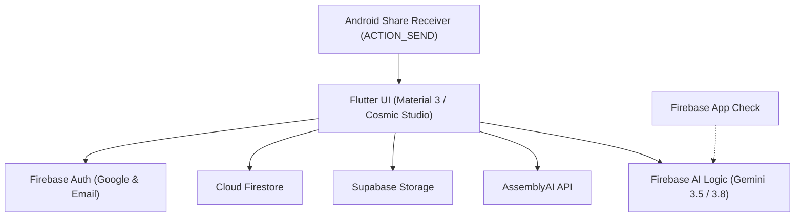

# EchoNotes 🎙️✨

> **Intelligent Voice-First Note-Taking & Grounded Knowledge Assistant for Android & iOS**

EchoNotes is a voice-first productivity and knowledge management application built with **Flutter**, **Firebase AI Logic (Google Gemini)**, and **AssemblyAI**. It enables users to record voice notes, transcribe speech with high fidelity, generate structured executive summaries, translate content across languages, and chat with an AI assistant that grounds its answers in your personal notes and collections.

---

## 📱 Visual Showcase

| Home & Notes Studio | Executive Summary & Reader | Collection AI Assistant | Share Import Preview |
| :---: | :---: | :---: | :---: |
| *(Add `screenshots/home.png`)* | *(Add `screenshots/summary.png`)* | *(Add `screenshots/collection_ai.png`)* | *(Add `screenshots/share_import.png`)* |

---

## 🌟 Key Features

### 1. 🎙️ Voice Capture & High-Fidelity Transcription
- **On-Device Audio Recording**: Clean recording interface with duration counters and real-time state feedback.
- **AssemblyAI Speech-to-Text**: Fast, accurate transcription supporting multiple audio formats (`.m4a`, `.mp3`, `.wav`, `.aac`, `.opus`, `.ogg`).
- **Cloud Storage**: Secure media staging via Supabase Storage buckets.
- **Progressive Content Reader**: Tailored reading experience capable of rendering 5,000+ word lecture transcripts without UI lag or memory strain.

### 2. ⚡ AI Note Intelligence (Google Gemini via Firebase AI Logic)
- **Executive Summaries**: One-tap structured synthesis breaking lengthy audio transcripts into key takeaways.
- **Smart Auto-Titling**: Generates concise, professional titles (3–6 words) that capture core themes without manual typing.
- **Action Items & Tone Hints**: Identifies key tasks, action items, and conversational tone.
- **Multi-Language Translation**: Instant transcript translation into Spanish, French, German, Chinese, Japanese, and more.
- **Single-Note Q&A**: Contextual AI dialog focusing strictly on the content of an individual note.

### 3. 📂 Echo Collections & Grounded RAG Assistant
- **Curated Collections**: Organize notes into custom folders with personalized icons, accent colors, and metadata.
- **Client-Side Lexical Retrieval (RAG)**: Tokenizes and segments notes into 350-word passages with overlapping windows, scoring relevance using keyword density and stopword filtration.
- **Grounded Citations**: The AI cites specific notes and passage snippets as evidence, preventing hallucinations and verifying accuracy.

### 4. 📲 Seamless External Audio Sharing (WhatsApp, Files, Voice Memos)
- **Direct System Sharing**: Registered Android intent filters (`audio/*`, `application/ogg`, `application/opus`) handle voice notes shared from apps like WhatsApp or Samsung Files.
- **Share Import Preview**: Users can preview audio playback, select a destination collection, and confirm import before transcription starts.
- **Resilient Cold & Warm Starts**: Preserves incoming payloads across authentication gates and cold app launches without data loss.

### 5. 🛡️ Enterprise-Grade Security & Authentication
- **Firebase App Check**: Protects Firebase AI Logic and backend endpoints against abuse using Android Debug Provider in development and Play Integrity in production.
- **Flexible Auth**: Support for Google Sign-In and secure Email/Password authentication via Firebase Auth and Cloud Firestore.
- **Private Environment Management**: Zero hardcoded secrets; API credentials and debug tokens load dynamically from `.env`.

---

## 🛠️ Tech Stack & Architecture



- **Frontend**: Flutter 3.x / Dart 3.x
- **UI Architecture**: Layered Feature-First Architecture (`lib/features/*`) with custom themes, responsive breakpoints, and micro-interactions
- **Backend & Cloud**:
  - **Firebase Authentication**: User identity and credential management
  - **Cloud Firestore**: Real-time note persistence, collections, and chat history
  - **Firebase App Check**: Device verification and endpoint protection
  - **Firebase AI Logic**: Official Google Gemini Developer API integration on the Spark plan
  - **Supabase Storage**: Audio asset staging
- **Audio Processing**:
  - `record`: High-fidelity audio capture
  - `audioplayers`: In-app audio playback and scrubber controls
  - `AssemblyAI`: Cloud speech-to-text transcription engine

---

## 📂 Repository Structure

```text
echo-notes/
├── android/                   # Native Android host app, manifests & Gradle config
├── assets/                    # Static branding, logo marks, and onboarding imagery
├── lib/
│   ├── core/                  # App routes, color tokens, and theme definitions
│   ├── features/
│   │   ├── auth/              # Email & Google Sign-In screens, logic, and state
│   │   ├── collections/       # Collection management and Grounded RAG AI chat
│   │   ├── legal/             # Terms of service and privacy documentation
│   │   ├── notes/             # Note creation, audio recording, detail & reader UI
│   │   ├── onboarding/        # First-launch onboarding flows
│   │   ├── share_receiver/    # Android share sheet receiver & import confirmation
│   │   └── splash/            # Animated entrance splash and auth-routing
│   ├── services/              # AssemblyAI, Gemini AI, Settings & Supabase services
│   ├── widgets/               # Reusable buttons, cards, dialogs, and audio waves
│   ├── firebase_options.dart  # Firebase platform configuration
│   └── main.dart              # Application entry point & service bootstrap
├── test/                      # Comprehensive unit, model, and widget test suites
├── .env.example               # Environment variables template
├── .gitignore                 # Production-grade version control exclusions
└── README.md                  # Project documentation
```

---

## 🚀 Getting Started

### Prerequisites
- [Flutter SDK](https://docs.flutter.dev/get-started/install) (version 3.24.0 or higher)
- [Android Studio](https://developer.android.com/studio) / Xcode
- A [Firebase Project](https://console.firebase.google.com/) with **Authentication**, **Firestore**, **App Check**, and **Firebase AI Logic** enabled
- An [AssemblyAI Account](https://www.assemblyai.com/) for transcription keys

### Installation Steps

1. **Clone the Repository**:
   ```bash
   git clone https://github.com/your-username/echo-notes.git
   cd echo-notes
   ```

2. **Install Dependencies**:
   ```bash
   flutter pub get
   ```

3. **Configure Environment Variables**:
   Copy `.env.example` to `.env`:
   ```bash
   cp .env.example .env
   ```
   Open `.env` and configure your credentials:
   ```properties
   ASSEMBLY_AI_KEY=your_assemblyai_api_key
   APP_CHECK_DEBUG_TOKEN=your_app_check_debug_token
   GOOGLE_WEB_CLIENT_ID=your_oauth_web_client_id.apps.googleusercontent.com
   ```

4. **Add Firebase Credentials**:
   - Place your `google-services.json` file inside `android/app/`.
   - Ensure your Android debug SHA-1 and SHA-256 fingerprints are registered in Firebase Console.

5. **Verify Installation**:
   Run static analysis and the automated test suite:
   ```bash
   flutter analyze
   flutter test
   ```

6. **Run the Application**:
   ```bash
   flutter run
   ```

---

## 🧪 Testing Suite

EchoNotes includes 47+ automated unit, widget, and model tests covering:
- **Audio Payload Validation**: Formats, size conversions, and MIME type handling
- **RAG & Passages**: Chunking, tokenization, BM25 scoring, and grounded citation verification
- **App Check Discrimination**: Distinguishing App Check attestation failure from Gemini 429 quota exhaustion
- **Responsive Layouts**: Validating overflow immunity across standard and compact screen widths (e.g. 320dp)
- **Theme Adaptation**: Light studio and cosmic dark palette switching

To execute all tests:
```bash
flutter test
```

---

## ⚠️ Known Limitations & Engineering Tradeoffs

- **Client-Side AssemblyAI Calls**: In this client-first testing build, AssemblyAI is called directly from the app. For enterprise production deployments, routing audio jobs through an authenticated cloud proxy (or Cloud Function) is recommended to prevent client credential exposure.
- **Firebase Spark Quota**: Gemini requests operate on the Firebase Spark tier with rate limits. The app includes active cooldown debouncing and graceful fallbacks when quotas are reached.
- **Physical Device App Check**: Running debug builds on physical hardware requires registering the unique debug secret in the Firebase Console under **App Check &rarr; Manage debug tokens**.

---

## 🔮 Future Roadmap

- [ ] **On-Device Offline STT**: Integration of quantized Whisper models via TensorFlow Lite / ONNX for offline voice notes.
- [ ] **Speaker Diarization**: Multi-speaker attribution during group discussions and interviews.
- [ ] **Desktop & Web Builds**: Cross-platform responsive support for macOS, Windows, and Web.
- [ ] **PDF & Markdown Export**: Export notes with audio links, summaries, and transcripts formatted for Obsidian or Notion.

---

## 📄 License

This project is open-source and available under the [MIT License](LICENSE).
